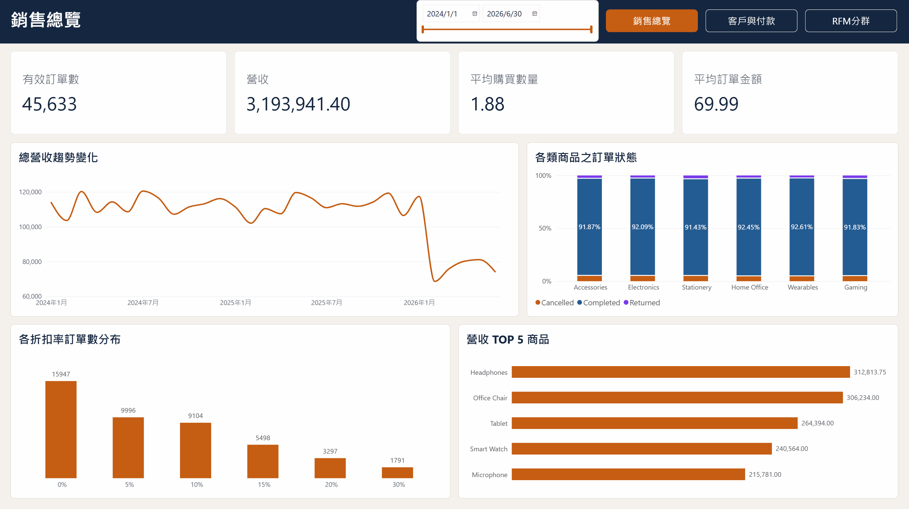
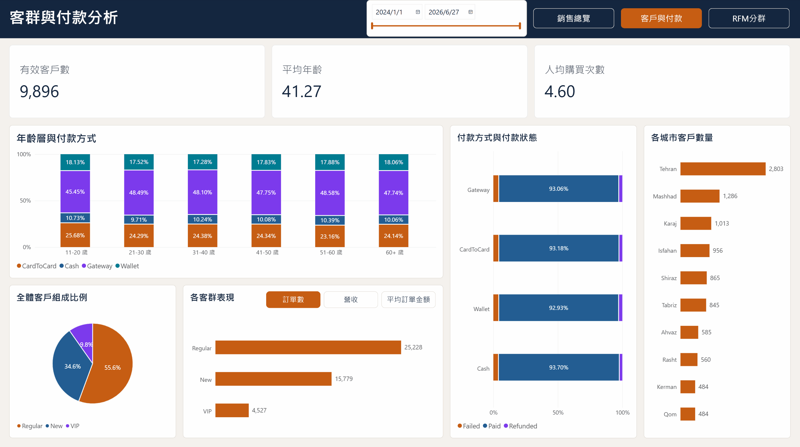
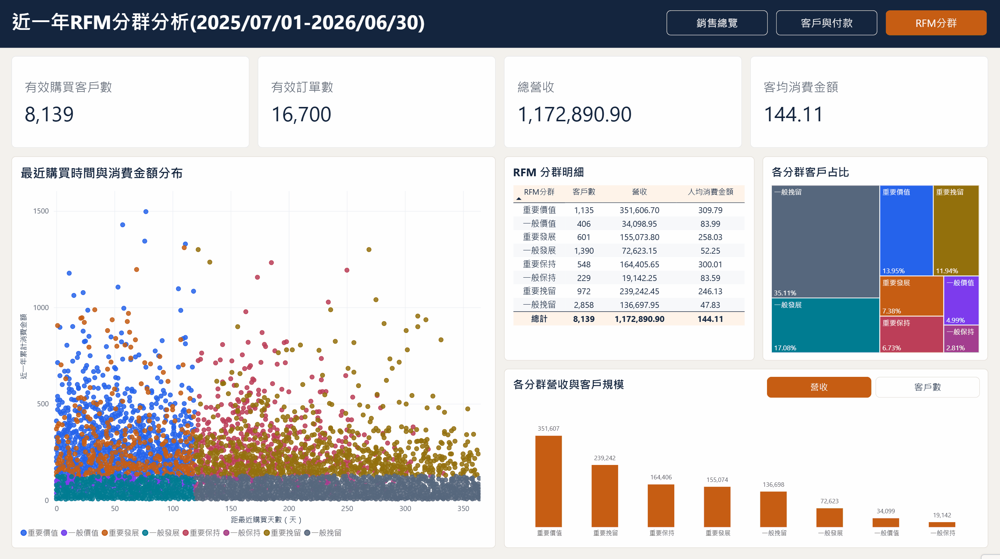

# 電商銷售資料分析

以下使用 Kaggle 資料集「E-Commerce Sales Data Analysis & EDA」
使用 Pandas 進行資料清理並輸出 CSV，
並透過 SQL Server 與 Pandas 進行資料品質檢查及多表分析，最後利用 Power BI 製作銷售、客群與 RFM 分群儀表板。

[Kaggle 資料集：E-Commerce Sales Data Analysis & EDA](https://www.kaggle.com/datasets/erfan4524/e-commerce-sales-data-analysis-and-eda)

## 一、分析定義與資料限制

- 資料限制:部分訂單日期早於客戶註冊日期，因此不使用註冊日期判斷訂單有效性；訂單狀態與付款狀態也存在不一致組合。其餘分析依照個別圖表目的篩選。
- 有效訂單:採 Status = Completed，並排除日期、數量及折扣缺值，營收不依付款狀態篩選。
- 營收計算:單價 * 購買數量 * (1 − 折扣率)
- RFM 分群定義:R 為最近有效訂單距資料截止日的天數，F、M 分別為截止日回推365天內的有效訂單數與營收。R、F、M 依設定門檻分為五個評分級距，再以近一年購買客戶的各項平均分數區分高低，組成八種客群。

## 二、Power BI 儀表板展示

### 報表頁面

#### P1. 銷售總覽

呈現整體營收、訂單數、平均購買數量及平均訂單金額等主要指標。

透過每月營收趨勢、各商品類別的訂單狀態、折扣幅度與訂單表現，以及營收前五名商品，觀察整體銷售情況與商品表現。



#### P2. 客戶與付款

從客戶年齡層、付款方式及客戶分類，觀察不同客群的消費與付款特徵。

分析各付款方式的成功、失敗及退款比例，並透過指標切換功能，比較不同客群的訂單數、營收與平均訂單金額。



#### P3. RFM分群

以 2025/07/01～2026/06/30 的有效訂單為基礎，將期間內的購買客戶劃分為八種 RFM 分群。

透過散佈圖、分群占比及營收與客戶規模比較，觀察不同客群的消費特徵與價值差異。



## 三、資料表結構

### orders

訂單主表，一筆資料代表一張訂單。

| 欄位 | 說明 |
|---|---|
| OrderID | 訂單編號 |
| CustomerID | 客戶編號 |
| OrderDate | 訂單日期 |
| ProductID | 商品編號 |
| Quantity | 購買數量 |
| Discount | 折扣 |
| PaymentMethod | 支付方式 |
| Status | 訂單狀態 |

### customers

客戶基本資料。

| 欄位 | 說明 |
|---|---|
| CustomerID | 客戶編號 |
| Age | 年齡 |
| City | 城市 |
| SignupDate | 註冊日期 |
| CustomerSegment | 客戶分群 |

### payments

訂單付款紀錄。

| 欄位 | 說明 |
|---|---|
| PaymentID | 付款編號 |
| OrderID | 訂單編號 |
| PaymentDate | 付款日期 |
| PaymentStatus | 付款狀態 |

### products

商品基本資料。

| 欄位 | 說明 |
|---|---|
| ProductID | 商品編號 |
| ProductName | 商品名稱 |
| Category | 商品大類 |
| UnitPrice | 商品單價 |

## 四、資料前處理

### 1. SQL 資料品質檢查

使用 SQL 進行整體資料品質的檢查。

#### 01｜重複資料與主鍵唯一性確認

確認訂單資料是否存在完全重複列，以及 OrderID 是否重複。
查詢後發現共有120筆多出的完全重複資料。

<details>
<summary>SQL</summary>

```sql
-- 完全重複列
SELECT
    OrderID,
    CustomerID,
    OrderDate,
    ProductID,
    Quantity,
    Discount,
    PaymentMethod,
    Status,
    COUNT(*) AS DuplicateCount
FROM dbo.orders
GROUP BY
    OrderID,
    CustomerID,
    OrderDate,
    ProductID,
    Quantity,
    Discount,
    PaymentMethod,
    Status
HAVING COUNT(*) > 1
ORDER BY OrderID;

-- OrderID 是否重複
SELECT
    OrderID,
    COUNT(*) AS OrderCount
FROM dbo.orders
GROUP BY OrderID
HAVING COUNT(*) > 1
ORDER BY OrderID;
```

</details>

#### 02｜NULL 確認

確認各表中各欄位的 NULL 數量，並判斷是否保留。

資料庫查詢後發現 NULL 資料分別為:

Orders 表(排除完全重複資料)：OrderDate 35筆、Quantity 99筆、Discount 220筆、PaymentMethod 450筆。

Payments 表：PaymentDate 35筆。

Products 表：無 NULL 資料。

Customers 表：Age 180筆、City 119筆。

<details>
<summary>SQL</summary>

```sql
WITH orders_dedup AS (
    SELECT DISTINCT *
    FROM orders
)
SELECT
    SUM(CASE WHEN OrderID IS NULL THEN 1 ELSE 0 END) AS Null_OrderID,
    SUM(CASE WHEN CustomerID IS NULL THEN 1 ELSE 0 END) AS Null_CustomerID,
    SUM(CASE WHEN ProductID IS NULL THEN 1 ELSE 0 END) AS Null_ProductID,
    SUM(CASE WHEN OrderDate IS NULL THEN 1 ELSE 0 END) AS Null_OrderDate,
    SUM(CASE WHEN Quantity IS NULL THEN 1 ELSE 0 END) AS Null_Quantity,
    SUM(CASE WHEN Discount IS NULL THEN 1 ELSE 0 END) AS Null_Discount,
    SUM(CASE WHEN PaymentMethod IS NULL THEN 1 ELSE 0 END) AS Null_PaymentMethod,
    SUM(CASE WHEN Status IS NULL THEN 1 ELSE 0 END) AS Null_Status
FROM orders_dedup;
SELECT 
    SUM(CASE WHEN PaymentID IS NULL THEN 1 ELSE 0 END) AS Null_PaymentID,
    SUM(CASE WHEN OrderID IS NULL THEN 1 ELSE 0 END) AS Null_OrderID,
    SUM(CASE WHEN PaymentDate IS NULL THEN 1 ELSE 0 END) AS Null_PaymentDate,
    SUM(CASE WHEN PaymentStatus IS NULL THEN 1 ELSE 0 END) AS Null_PaymentStatus
FROM payments;
SELECT 
    SUM(CASE WHEN ProductID IS NULL THEN 1 ELSE 0 END) AS Null_ProductID,
    SUM(CASE WHEN ProductName IS NULL THEN 1 ELSE 0 END) AS Null_ProductName,
    SUM(CASE WHEN Category IS NULL THEN 1 ELSE 0 END) AS Null_Category,
    SUM(CASE WHEN UnitPrice IS NULL THEN 1 ELSE 0 END) AS Null_UnitPrice
FROM products;
SELECT 
    SUM(CASE WHEN CustomerID IS NULL THEN 1 ELSE 0 END) AS Null_CustomerID,
    SUM(CASE WHEN SignupDate IS NULL THEN 1 ELSE 0 END) AS Null_SignupDate,
    SUM(CASE WHEN Age IS NULL THEN 1 ELSE 0 END) AS Null_Age,
    SUM(CASE WHEN City IS NULL THEN 1 ELSE 0 END) AS Null_City,
    SUM(CASE WHEN CustomerSegment IS NULL THEN 1 ELSE 0 END) AS Null_CustomerSegment
FROM customers;
```

</details>

#### 03｜數值範圍與類別值確認

確認折扣幅度、數量、單價、年齡等欄位是否有不正常數據。
確認支付狀態及客戶分類的類型。

查詢後發現 Quantity 欄位有六筆數量為0。

<details>
<summary>SQL</summary>

```sql
SELECT DISTINCT *
FROM orders
WHERE Discount < 0
   OR Discount > 1;

SELECT DISTINCT *
FROM orders
WHERE Quantity <= 0;

SELECT *
FROM products
WHERE UnitPrice <= 0;

SELECT Age
FROM customers
WHERE Age < 0
   OR Age > 120;

SELECT DISTINCT Status
FROM orders;

SELECT DISTINCT PaymentMethod
FROM orders;

SELECT DISTINCT PaymentStatus
FROM payments;

SELECT DISTINCT CustomerSegment
FROM customers;

SELECT DISTINCT Category
FROM products;
```

</details>

#### 04｜關聯完整性確認

檢查各資料表之間是否存在無法對應的關聯資料。

查詢後發現有30筆訂單的 CustomerID 為999999，無法與客戶資料對應。

<details>
<summary>SQL</summary>

```sql
SELECT DISTINCT o.*
FROM orders AS o
LEFT JOIN customers AS c
    ON o.CustomerID = c.CustomerID
WHERE c.CustomerID IS NULL;

SELECT DISTINCT o.*
FROM orders AS o
LEFT JOIN products AS p
    ON o.ProductID = p.ProductID
WHERE p.ProductID IS NULL;

SELECT p.*
FROM payments AS p
LEFT JOIN orders AS o
    ON p.OrderID = o.OrderID
WHERE o.OrderID IS NULL;
```

</details>

### 2. SQL 資料清理與 View 建立

使用 SQL 清理資料並建立分析用 View。

#### 01｜資料型別調整

調整部分資料欄位型別。

<details>
<summary>SQL</summary>

```sql
ALTER TABLE orders
ALTER COLUMN Discount DECIMAL(4, 2) NULL;

ALTER TABLE orders
ALTER COLUMN Quantity INT NULL;

ALTER TABLE customers
ALTER COLUMN Age INT NULL;
```

</details>

#### 02｜建立 orders 分析用 View

建立分析用 orders View，去除完全重複列、數量非正以及無法對應客戶的訂單，保留原始訂單資料列。

<details>
<summary>SQL</summary>

```sql
GO

CREATE OR ALTER VIEW dbo.vw_orders_clean AS
SELECT DISTINCT o.*
FROM dbo.orders AS o
WHERE
    (o.Quantity > 0 OR o.Quantity IS NULL)
    AND EXISTS (
        SELECT 1
        FROM dbo.customers AS c
        WHERE c.CustomerID = o.CustomerID
    );

GO
```

</details>

#### 03｜建立 payments 分析用 View

建立分析用 payments View，保留對應清理後訂單的付款紀錄。

<details>
<summary>SQL</summary>

```sql
CREATE OR ALTER VIEW dbo.vw_payments_clean AS
SELECT p.*
FROM dbo.payments AS p
WHERE EXISTS (
    SELECT 1
    FROM dbo.vw_orders_clean AS o
    WHERE o.OrderID = p.OrderID
);

GO
```

</details>

### 3. Pandas 資料清理與 CSV 輸出

使用 Pandas 清理資料並建立分析用 CSV。

#### 01｜重複資料處理

移除完全重複資料。

<details>
<summary>Pandas</summary>

```python
orders_clean = orders.drop_duplicates().copy()
```

</details>

#### 02｜異常值處理

移除數量不為正數的訂單，但保留缺值。

<details>
<summary>Pandas</summary>

```python
orders_clean = orders_clean.loc[
    orders_clean["Quantity"].isna()
    | (orders_clean["Quantity"] > 0)
].copy()
```

</details>

#### 03｜關聯完整性處理

移除無法對應客戶的訂單，同步篩選付款紀錄。

<details>
<summary>Pandas</summary>

```python
orders_clean = orders_clean.loc[
    orders_clean["CustomerID"].isin(customers["CustomerID"])
].copy()
payments_clean = payments.loc[
    payments["OrderID"].isin(orders_clean["OrderID"])
].copy()
customers_clean = customers.copy()
products_clean = products.copy()
```

</details>

#### 04｜資料型別調整

調整日期、數字型別。

<details>
<summary>Pandas</summary>

```python
orders_clean["OrderDate"] = pd.to_datetime(
    orders_clean["OrderDate"],
    errors="coerce",
)

customers_clean["SignupDate"] = pd.to_datetime(
    customers_clean["SignupDate"],
    errors="coerce",
)

payments_clean["PaymentDate"] = pd.to_datetime(
    payments_clean["PaymentDate"],
    errors="coerce",
)

orders_clean["Quantity"] = orders_clean["Quantity"].astype("Int64")
customers_clean["Age"] = customers_clean["Age"].astype("Int64")
```

</details>

#### 05｜輸出前驗證

<details>
<summary>Pandas</summary>

```python
assert orders_clean.duplicated().sum() == 0
assert orders_clean["OrderID"].is_unique
assert customers_clean["CustomerID"].is_unique
assert products_clean["ProductID"].is_unique
assert payments_clean["PaymentID"].is_unique
assert payments_clean["OrderID"].is_unique

assert not (orders_clean["Quantity"].dropna() <= 0).any()

assert orders_clean["CustomerID"].isin(customers_clean["CustomerID"]).all()
assert orders_clean["ProductID"].isin(products_clean["ProductID"]).all()
assert payments_clean["OrderID"].isin(orders_clean["OrderID"]).all()
```

</details>

#### 06｜建立分析用 csv

<details>
<summary>Pandas</summary>

```python
orders_clean.to_csv("E-Commerce Sales/clean_csv/orders_clean.csv", index=False)
customers_clean.to_csv("E-Commerce Sales/clean_csv/customers_clean.csv", index=False)
products_clean.to_csv("E-Commerce Sales/clean_csv/products_clean.csv", index=False)
payments_clean.to_csv("E-Commerce Sales/clean_csv/payments_clean.csv", index=False)
```

</details>

## 五、資料查詢

### 01｜每月營收、訂單量與銷售量的趨勢如何？

依月份彙總已完成訂單，計算營收、訂單量與銷售量。

<details>
<summary>SQL</summary>

```sql
SELECT
    CONVERT (CHAR (7), o.OrderDate, 126) AS 年月,
    ROUND(
        SUM(p.UnitPrice * (1 - o.Discount) * o.Quantity),
        2
    ) AS 每月營收,
    COUNT(DISTINCT o.orderID) AS 訂單量,
    SUM(o.Quantity) AS 銷售量
FROM
    vw_orders_clean AS o
    INNER JOIN products AS p ON o.ProductID = p.ProductID
WHERE
    o.Quantity IS NOT NULL
    AND o.OrderDate IS NOT NULL
    AND o.Discount IS NOT NULL
    AND o.Status = 'Completed'
GROUP BY
    CONVERT (CHAR (7), o.OrderDate, 126)
ORDER BY
    年月;
```

</details>

<details>
<summary>Pandas</summary>

```python
df1 = pd.merge(orders, products, on="ProductID")
df1["年月"] = df1["OrderDate"].dt.strftime("%Y-%m")
df1["每月營收"] = df1["UnitPrice"] * (1 - df1["Discount"]) * df1["Quantity"]
df1 = (
    df1.loc[
        (df1["Quantity"].notna())
        & (df1["OrderDate"].notna())
        & (df1["Discount"].notna())
        & (df1["Status"] == "Completed")
    ]
    .groupby("年月", as_index=False)
    .agg(
        每月營收=("每月營收", "sum"),
        訂單量=("OrderID", "nunique"),
        銷售量=("Quantity", "sum"),
    )
    .sort_values("年月")
)
df1["每月營收"] = df1["每月營收"].round(2)
print(df1.to_string(index=False))
```

</details>

### 02｜不同折扣幅度下，訂單數與平均購買數量是否有差異？

依折扣幅度分組，比較訂單數與平均購買數量。

<details>
<summary>SQL</summary>

```sql
SELECT
    Discount AS 折扣幅度,
    COUNT(DISTINCT OrderID) AS 訂單數,
    CAST(AVG(Quantity * 1.0) AS DECIMAL(5, 2)) AS 平均購買數量
from
    vw_orders_clean
WHERE
    Discount IS NOT NULL
    AND Quantity IS NOT NULL
    AND Status = 'Completed'
GROUP BY
    Discount
ORDER BY
    Discount;
```

</details>

<details>
<summary>Pandas</summary>

```python
df2 = (
    orders.loc[
        (orders["Quantity"].notna())
        & (orders["Discount"].notna())
        & (orders["Status"] == "Completed")
    ]
    .groupby("Discount", as_index=False)
    .agg(訂單數=("OrderID", "nunique"), 平均購買數量=("Quantity", "mean"))
    .rename(columns={"Discount": "折扣"})
)
df2["平均購買數量"] = df2["平均購買數量"].round(2)
print(df2.to_string(index=False))
```

</details>

### 03｜不同年齡層的支付方式使用比例有何差異？

依年齡層分組，比較不同支付方式的使用比例。

<details>
<summary>SQL</summary>

```sql
WITH 年齡層 AS (
    SELECT
        CASE
            WHEN c.Age BETWEEN 0
            AND 10 THEN '0-10 歲'
            WHEN c.Age BETWEEN 11
            AND 20 THEN '11-20 歲'
            WHEN c.Age BETWEEN 21
            AND 30 THEN '21-30 歲'
            WHEN c.Age BETWEEN 31
            AND 40 THEN '31-40 歲'
            WHEN c.Age BETWEEN 41
            AND 50 THEN '41-50 歲'
            WHEN c.Age BETWEEN 51
            AND 60 THEN '51-60 歲'
            WHEN c.Age > 60 THEN '60+ 歲'
            ELSE NULL
        END AS 年齡層,
        o.PaymentMethod AS 支付方式
    FROM
        vw_orders_clean o
        JOIN customers c ON o.CustomerID = c.CustomerID
)
SELECT
    年齡層,
    COUNT(*) AS 訂單數,
    CAST(
        SUM(
            CASE
                WHEN 支付方式 = 'CardToCard' THEN 1.0
                ELSE 0
            END
        ) / COUNT(*) * 100 AS DECIMAL(5, 2)
    ) AS 卡片轉帳,
    CAST(
        SUM(
            CASE
                WHEN 支付方式 = 'Cash' THEN 1.0
                ELSE 0
            END
        ) / COUNT(*) * 100 AS DECIMAL(5, 2)
    ) AS 現金,
    CAST(
        SUM(
            CASE
                WHEN 支付方式 = 'Gateway' THEN 1.0
                ELSE 0
            END
        ) / COUNT(*) * 100 AS DECIMAL(5, 2)
    ) AS 第三方支付,
    CAST(
        SUM(
            CASE
                WHEN 支付方式 = 'Wallet' THEN 1.0
                ELSE 0
            END
        ) / COUNT(*) * 100 AS DECIMAL(5, 2)
    ) AS 電子錢包
FROM
    年齡層
WHERE
    年齡層 IS NOT NULL
    AND 支付方式 IS NOT NULL
GROUP BY
    年齡層
ORDER BY
    年齡層;
```

</details>

<details>
<summary>Pandas</summary>

```python
df3 = pd.merge(orders, customers, on="CustomerID")
df3["年齡層"] = pd.cut(
    df3["Age"],
    bins=[0, 10, 20, 30, 40, 50, 60, float("inf")],
    labels=[
        "0-10 歲",
        "11-20 歲",
        "21-30 歲",
        "31-40 歲",
        "41-50 歲",
        "51-60 歲",
        "60+ 歲",
    ],
    include_lowest=True,
)
df3["卡片轉帳"] = (df3["PaymentMethod"] == "CardToCard").astype(int)
df3["現金"] = (df3["PaymentMethod"] == "Cash").astype(int)
df3["第三方支付"] = (df3["PaymentMethod"] == "Gateway").astype(int)
df3["電子錢包"] = (df3["PaymentMethod"] == "Wallet").astype(int)
df3 = (
    df3.loc[(df3["年齡層"].notna()) & (df3["PaymentMethod"].notna())]
    .groupby("年齡層", as_index=False, observed=True)
    .agg(
        訂單數=("OrderID", "nunique"),
        卡片轉帳=("卡片轉帳", "mean"),
        現金=("現金", "mean"),
        第三方支付=("第三方支付", "mean"),
        電子錢包=("電子錢包", "mean"),
    )
)
df3["卡片轉帳"] = (df3["卡片轉帳"] * 100).round(2)
df3["現金"] = (df3["現金"] * 100).round(2)
df3["第三方支付"] = (df3["第三方支付"] * 100).round(2)
df3["電子錢包"] = (df3["電子錢包"] * 100).round(2)
print(df3.to_string(index=False))
```

</details>

### 04｜各月份營收最高的 Top 5 商品，其年度營收排名為何？

依月份彙總出營收前五高的商品，並比較不同商品的年度營收排名。

<details>
<summary>SQL</summary>

```sql
WITH 基礎銷售資料 AS (
    SELECT
        CONVERT(CHAR(4), o.OrderDate, 126) AS 年,
        CONVERT(CHAR(7), o.OrderDate, 126) AS 年月,
        o.ProductID AS 商品編號,
        p.ProductName AS 商品名稱,
        p.UnitPrice * (1 - o.Discount) * o.Quantity AS 營收
    FROM
        vw_orders_clean AS o
        INNER JOIN products AS p ON o.ProductID = p.ProductID
    WHERE
        o.Quantity IS NOT NULL
        AND o.OrderDate IS NOT NULL
        AND o.Discount IS NOT NULL
        AND o.Status = 'Completed'
),
年商品營收排名 AS (
    SELECT
        年,
        商品編號,
        商品名稱,
        ROUND(SUM(營收), 2) AS 每年營收,
        RANK() OVER(
            PARTITION BY 年
            ORDER BY
                SUM(營收) DESC
        ) AS 各年營收排名
    FROM
        基礎銷售資料
    GROUP BY
        年,
        商品編號,
        商品名稱
),
月商品營收排名 AS (
    SELECT
        年,
        年月,
        商品編號,
        商品名稱,
        ROUND(SUM(營收), 2) AS 每月營收,
        RANK() OVER (
            PARTITION BY 年月
            ORDER BY
                SUM(營收) DESC
        ) AS 各月營收排名
    FROM
        基礎銷售資料
    GROUP BY
        年,
        年月,
        商品編號,
        商品名稱
)
SELECT
    m.*,
    y.每年營收,
    y.各年營收排名
FROM
    年商品營收排名 y
    JOIN 月商品營收排名 m ON y.年 = m.年
    AND y.商品編號 = m.商品編號
WHERE
    各月營收排名 <= 5
ORDER BY
    年月,
    各月營收排名;
```

</details>

<details>
<summary>Pandas</summary>

```python
df4 = pd.merge(orders, products, on="ProductID")
df4["年"] = df4["OrderDate"].dt.strftime("%Y")
df4["年月"] = df4["OrderDate"].dt.strftime("%Y-%m")
df4 = df4.loc[
    (df4["Quantity"].notna())
    & (df4["OrderDate"].notna())
    & (df4["Discount"].notna())
    & (df4["Status"] == "Completed")
].copy()
df4["營收"] = df4["UnitPrice"] * (1 - df4["Discount"]) * df4["Quantity"]
monthly_sales = (
    df4.groupby(["年", "年月", "ProductID", "ProductName"], as_index=False)
    .agg(每月營收=("營收", "sum"))
    .round(2)
)
monthly_sales["各月營收排名"] = (
    monthly_sales.groupby("年月")["每月營收"]
    .rank(method="min", ascending=False)
    .astype(int)
)
yearly_sales = (
    df4.groupby(["年", "ProductID", "ProductName"], as_index=False)
    .agg(每年營收=("營收", "sum"))
    .round(2)
)
yearly_sales["各年營收排名"] = (
    yearly_sales.groupby("年")["每年營收"]
    .rank(method="min", ascending=False)
    .astype(int)
)
df4 = pd.merge(monthly_sales, yearly_sales, on=["年", "ProductID", "ProductName"])

df4 = df4.loc[df4["各月營收排名"] <= 5].sort_values(["年月", "各月營收排名"])
print(df4.to_string(index=False))
```

</details>

### 05｜不同客戶分類的營收、訂單量與平均訂單金額有何差異？

依客戶分類分組，比較營收、訂單量與平均訂單金額。

<details>
<summary>SQL</summary>

```sql
SELECT
    c.CustomerSegment,
    CAST(
        SUM(p.UnitPrice * (1 - o.Discount) * o.Quantity) AS DECIMAL(18, 2)
    ) AS 總營收,
    COUNT(DISTINCT o.OrderID) AS 訂單量,
    CAST(
        AVG(p.UnitPrice * (1 - o.Discount) * o.Quantity) AS DECIMAL(18, 2)
    ) AS 平均訂單金額
FROM
    vw_orders_clean o
    JOIN customers c ON o.CustomerID = c.CustomerID
    JOIN products p ON o.ProductID = p.ProductID
WHERE
    o.Quantity IS NOT NULL
    AND o.Discount IS NOT NULL
    AND o.Status = 'Completed'
GROUP BY
    c.CustomerSegment
ORDER BY
    總營收 DESC;
```

</details>

<details>
<summary>Pandas</summary>

```python
orders_customers = pd.merge(orders, customers, on="CustomerID")
df5 = pd.merge(orders_customers, products, on="ProductID")
df5["營收"] = df5["UnitPrice"] * (1 - df5["Discount"]) * df5["Quantity"]
df5 = (
    df5.loc[
        (df5["Quantity"].notna())
        & (df5["Discount"].notna())
        & (df5["Status"] == "Completed")
    ]
    .groupby("CustomerSegment", as_index=False)
    .agg(
        總營收=("營收", "sum"),
        訂單量=("OrderID", "nunique"),
        平均訂單金額=("營收", "mean"),
    )
    .sort_values("總營收", ascending=False)
)
df5["總營收"] = df5["總營收"].round(2)
df5["平均訂單金額"] = df5["平均訂單金額"].round(2)
print(df5.to_string(index=False))
```

</details>

### 06｜不同商品類別的完成、取消與退貨訂單比例有何差異？

依商品類別分組，比較訂單的完成、取消與退貨比例。

<details>
<summary>SQL</summary>

```sql
SELECT
    p.Category,
    CAST(
        COUNT(
            DISTINCT CASE
                WHEN o.Status = 'Completed' THEN o.OrderID
            END
        ) * 100.0 / COUNT(DISTINCT o.OrderID) AS DECIMAL(5, 2)
    ) AS 完成百分比,
    CAST(
        COUNT(
            DISTINCT CASE
                WHEN o.Status = 'Cancelled' THEN o.OrderID
            END
        ) * 100.0 / COUNT(DISTINCT o.OrderID) AS DECIMAL(5, 2)
    ) AS 取消百分比,
    CAST(
        COUNT(
            DISTINCT CASE
                WHEN o.Status = 'Returned' THEN o.OrderID
            END
        ) * 100.0 / COUNT(DISTINCT o.OrderID) AS DECIMAL(5, 2)
    ) AS 退貨百分比
FROM
    vw_orders_clean o
    JOIN products p ON o.ProductID = p.ProductID
GROUP BY
    p.Category;
```

</details>

<details>
<summary>Pandas</summary>

```python
df6 = pd.merge(orders, products, on="ProductID")
df6["完成"] = (df6["Status"] == "Completed").astype(int)
df6["取消"] = (df6["Status"] == "Cancelled").astype(int)
df6["退貨"] = (df6["Status"] == "Returned").astype(int)
df6 = df6.groupby("Category", as_index=False).agg(
    完成訂單比例=("完成", "mean"),
    取消訂單比例=("取消", "mean"),
    退貨訂單比例=("退貨", "mean"),
)
df6["完成訂單比例"] = (df6["完成訂單比例"] * 100).round(2)
df6["取消訂單比例"] = (df6["取消訂單比例"] * 100).round(2)
df6["退貨訂單比例"] = (df6["退貨訂單比例"] * 100).round(2)
print(df6.to_string(index=False))
```

</details>

### 07｜各商品的平均購買年齡為何？

依商品名稱分組，比較平均購買年齡。

<details>
<summary>SQL</summary>

```sql
SELECT
    p.ProductID,
    p.ProductName,
    CAST(AVG(c.Age * 1.0) AS DECIMAL(5, 1)) AS 平均購買年齡
FROM
    vw_orders_clean AS o
    INNER JOIN customers AS c ON o.CustomerID = c.CustomerID
    INNER JOIN products AS p ON o.ProductID = p.ProductID
WHERE
    o.Quantity IS NOT NULL
GROUP BY
    p.ProductID,
    p.ProductName;
```

</details>

<details>
<summary>Pandas</summary>

```python
orders_customers = pd.merge(orders, customers, on="CustomerID")
df7 = pd.merge(orders_customers, products, on="ProductID")
df7 = (
    df7.loc[df7["Quantity"].notna()]
    .groupby(["ProductID", "ProductName"], as_index=False)
    .agg(平均年齡=("Age", "mean"))
)
df7["平均年齡"] = df7["平均年齡"].round(1)
print(df7.to_string(index=False))
```

</details>

### 08｜不同支付方式的付款成功、失敗與退款比例是否有差異？

依支付方式分組，比較付款成功、失敗與退款占比。

<details>
<summary>SQL</summary>

```sql
SELECT
    o.PaymentMethod AS 付款方式,
    COUNT(*) AS 訂單數,
    CAST(
        SUM(
            CASE
                WHEN p.PaymentStatus = 'Paid' THEN 1.0
                ELSE 0
            END
        ) / COUNT(*) * 100 AS DECIMAL(5, 2)
    ) AS 付款成功率,
    CAST(
        SUM(
            CASE
                WHEN p.PaymentStatus = 'Failed' THEN 1.0
                ELSE 0
            END
        ) / COUNT(*) * 100 AS DECIMAL(5, 2)
    ) AS 付款失敗率,
    CAST(
        SUM(
            CASE
                WHEN p.PaymentStatus = 'Refunded' THEN 1.0
                ELSE 0
            END
        ) / COUNT(*) * 100 AS DECIMAL(5, 2)
    ) AS 退款率
FROM
    vw_orders_clean o
    JOIN vw_payments_clean p ON o.OrderID = p.OrderID
WHERE
    o.PaymentMethod IS NOT NULL
GROUP BY
    o.PaymentMethod
ORDER BY
    訂單數 DESC
```

</details>

<details>
<summary>Pandas</summary>

```python
df8 = pd.merge(orders, payments, on="OrderID")
df8["付款成功"] = (df8["PaymentStatus"] == "Paid").astype(int)
df8["付款失敗"] = (df8["PaymentStatus"] == "Failed").astype(int)
df8["退款"] = (df8["PaymentStatus"] == "Refunded").astype(int)
df8 = (
    df8.loc[df8["PaymentMethod"].notna()]
    .groupby("PaymentMethod", as_index=False)
    .agg(
        訂單數=("OrderID", "nunique"),
        付款成功率=("付款成功", "mean"),
        付款失敗率=("付款失敗", "mean"),
        退款率=("退款", "mean"),
    )
    .sort_values("訂單數", ascending=False)
)
df8 = df8.rename(columns={"PaymentMethod": "付款方式"})
df8["付款成功率"] = (df8["付款成功率"] * 100).round(2)
df8["付款失敗率"] = (df8["付款失敗率"] * 100).round(2)
df8["退款率"] = (df8["退款率"] * 100).round(2)
print(df8.to_string(index=False))
```

</details>
