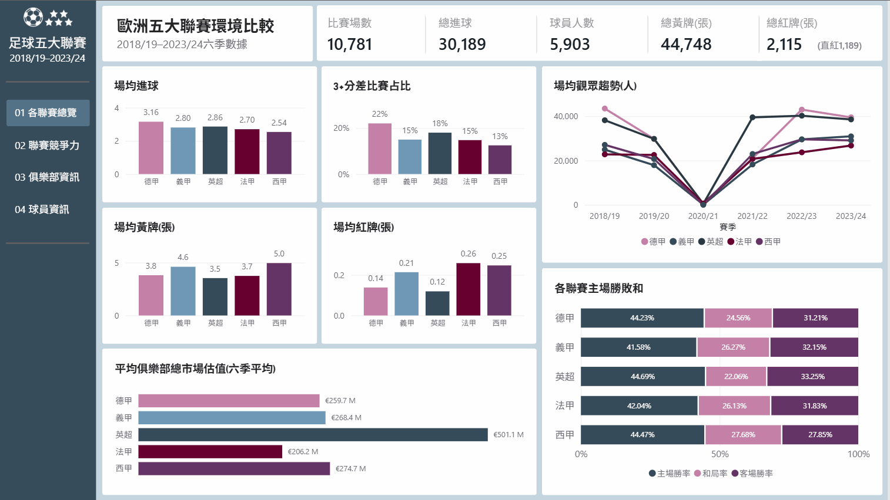
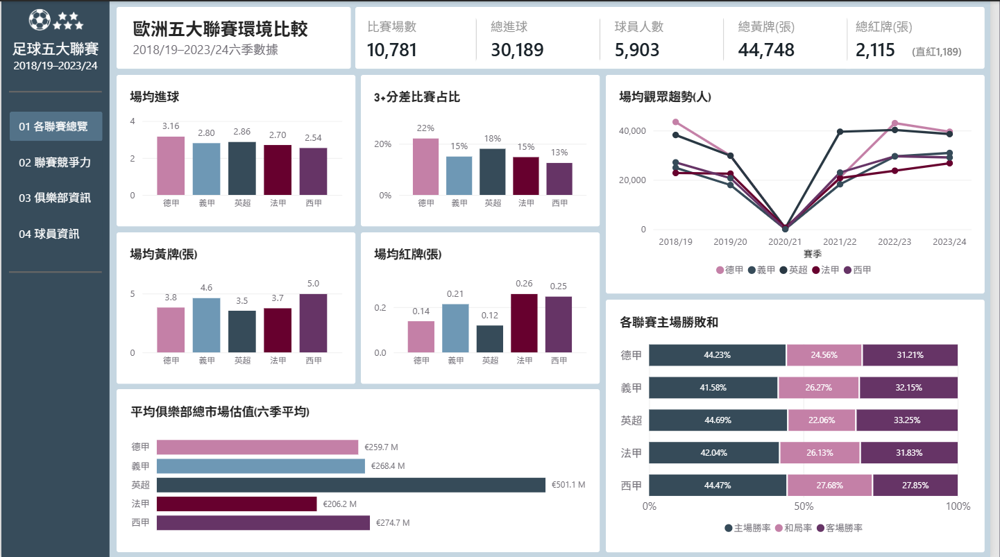
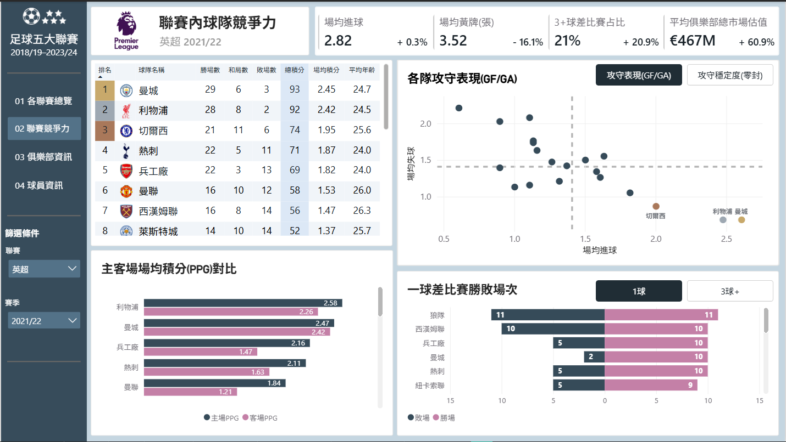
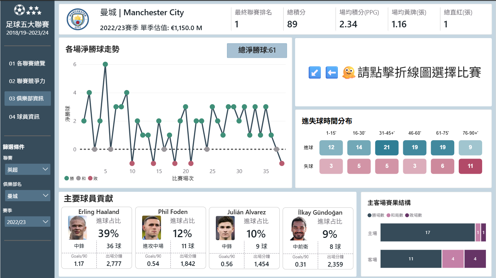
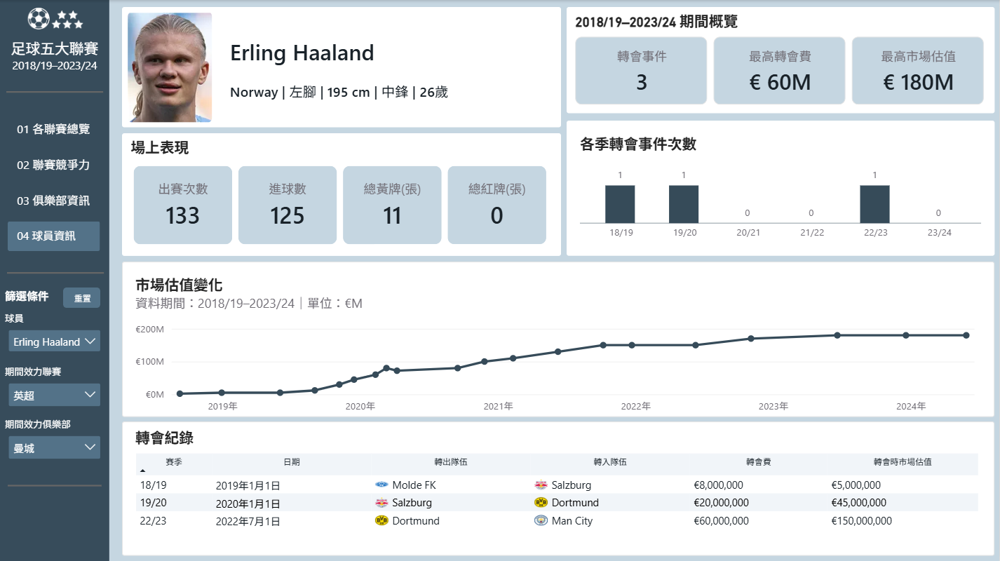

# 歐洲五大足球聯賽分析儀表板

透過 Power BI 整合 2018/19–2023/24 五大聯賽資料，建立可由聯賽總覽逐步深入至俱樂部、單場比賽與球員層級的互動式報表，支援不同層級之間的比較與探索。
適合一般足球迷、內容創作者與足球資料愛好者，用於快速比較聯賽與球隊表現、尋找異常或有趣案例，並作為後續深入研究的起點。

## Preview

## 報表頁面

### P1. 聯賽總覽

比較不同聯賽的整體表現與主要指標。
包含場均進球、場均黃紅牌、大比分差比賽占比、主場勝／和／敗及市場估值和觀眾人數比較。

### P2. 聯賽分析

透過進攻／防守散佈圖與排名觀察球隊表現。
包含聯賽內積分及勝／和／敗紀錄、各隊攻守表現與穩定度、主客場勝／和／敗占比及不同分差比賽占比。

### P3. 球隊分析

檢視球隊賽季淨勝球變化、主要進球射手等資訊。
包含隊伍賽季淨勝球走勢、進失球時間分布、主客場勝敗和占比及主要進球球員。

### P4. 球員分析

檢視球員轉會紀錄與市場估值變化等資訊。
包含球員個人基本數據、轉會事件次數、轉會費及市場估值變化，以及轉會紀錄。

## 資料處理

- 使用 Power Query 篩選出完整度較高的賽季區間作為主要分析範圍。
- 使用 Power Query 合併資料表、處理 NULL 值，並建立可用於分析之模型架構。
- 使用 Power BI 建立聯賽、球隊、賽季、日期與事實表之間的模型關聯。

## 使用工具

- Power BI
- Power Query
- DAX
- Deneb

## 資料來源

[Kaggle 資料集：Football Data from Transfermarkt](https://www.kaggle.com/datasets/davidcariboo/player-scores)
