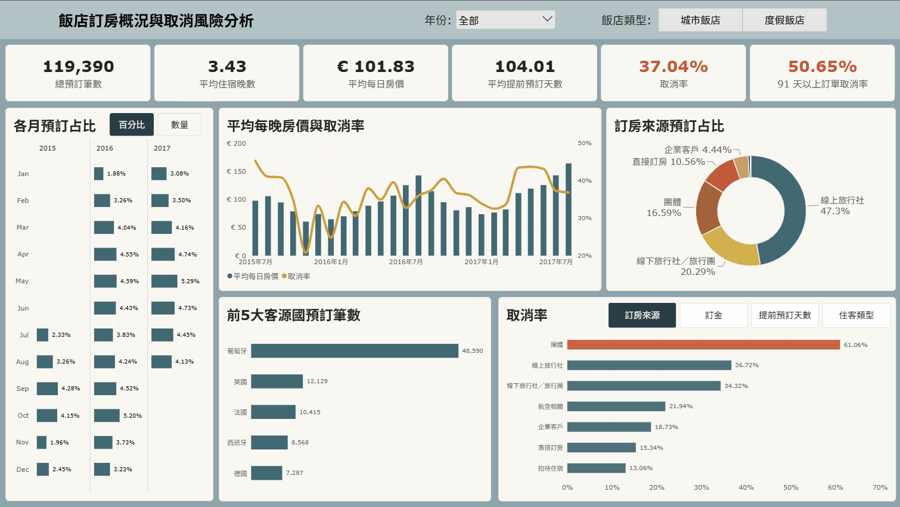

# Hotel Booking Dashboard

使用 Hotel Booking Demand 資料集建立 Power BI 儀表板，從訂房量、取消率、提前預訂天數與不同客群等面向觀察飯店訂房與取消情況。

## 分析目的

- 比較不同月份的預訂量與取消率變化
- 觀察平均每日房價與取消率的時間趨勢
- 分析不同訂房來源的預訂占比與取消情況
- 比較主要客源國的預訂量
- 觀察長提前預訂訂單的取消風險
  
## Preview

## 資料處理

- 整理日期欄位並建立日期維度表
- 處理住客人數與房價異常值
- 將提前預訂天數劃分為不同區間
- 建立國家與提前預訂區間等維度表
  
## 使用工具

- Power BI
- Power Query
- DAX

## 資料來源

[Kaggle 資料集：Hotel Booking Demand](https://www.kaggle.com/datasets/jessemostipak/hotel-booking-demand)
